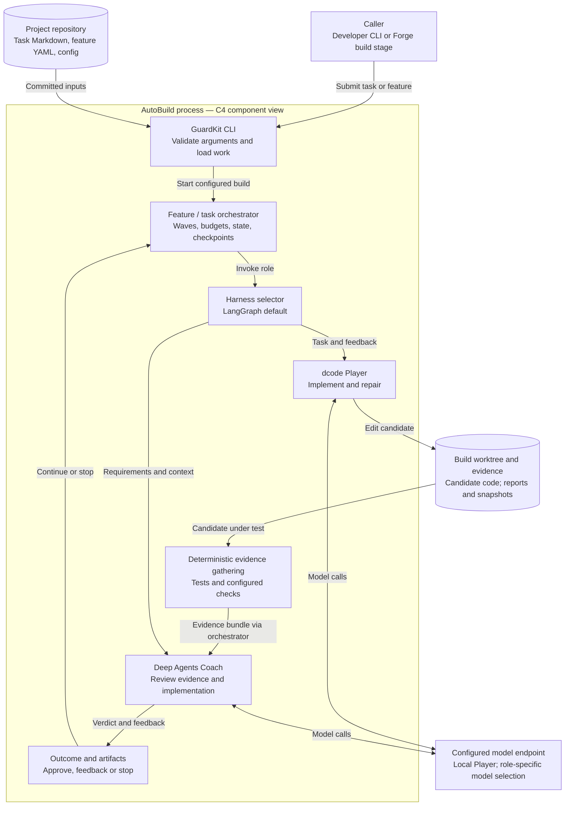
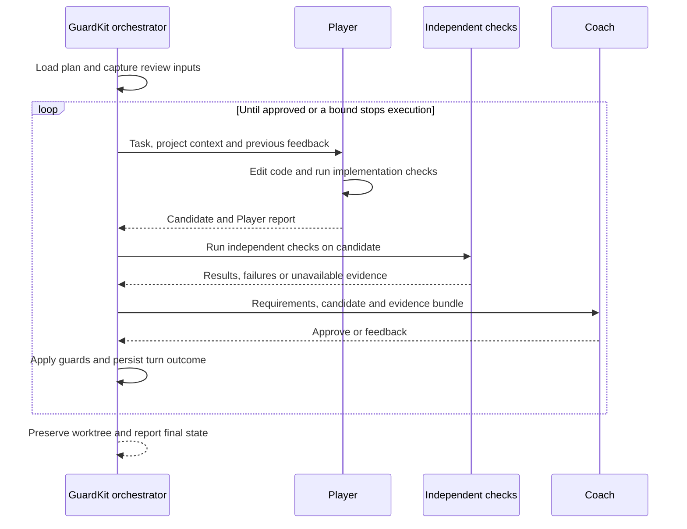

# How AutoBuild currently works

AutoBuild is GuardKit's build engine. It loads a task or feature plan, prepares a Git worktree, runs a bounded Player–Coach loop and preserves the result for review. The Software Factory invokes this engine as part of a longer lifecycle. The Python package named `guardkitfactory` supplies its agent harness; it is not the entire factory.

**Verified 17 October 2026:** GuardKit `23d99208598706f81f43a21628f5dcfb89d92a55`, guardkitfactory `40615a7e0ff6952b5a5492ada0d3a66dc10c8533`. This is a source-backed architecture description, not a fresh production acceptance test.

[Download full-size diagrams for slides](../learning/presentation-kit.md#reuse-the-diagrams).

## C4 component view: the build process

This view zooms into the AutoBuild process. The boxes within the boundary are code components and libraries, not independently deployed services. The [Software Factory architecture](../software-factory/index.md) covers the service boundary.



The default adapter is selected by `GUARDKIT_HARNESS`, with `langgraph` as the default and `sdk` as an explicit Claude Agent SDK alternative for standalone use. Factory launches reject the SDK path because its shell inherits the full process environment. Unknown values fail rather than silently choosing another runtime. [Selector](https://github.com/guardkit/guardkit/blob/23d99208598706f81f43a21628f5dcfb89d92a55/guardkit/orchestrator/harness/selector.py)

## The Player and Coach are different roles

The current LangGraph Player is **dcode**, constructed with validated project context. The earlier native Player implementation is retired: a missing or incompatible dcode configuration is an error, not a fallback. The harness pins `deepagents==0.7.14` and `deepagents-code==0.1.69`. A dedicated run profile keeps unrelated personal skills, plugins and memory out of the Player's launch context. The normal Player requires an explicit local model alias and endpoint.

The Coach is constructed through Deep Agents. It receives independent evidence and the requirements, inspects the candidate, and returns approval or actionable feedback. Player and Coach can use different models through `--model` and `--coach-model`; two roles do not by themselves establish independent model behaviour. [Harness construction](https://github.com/guardkit/guardkitfactory/blob/40615a7e0ff6952b5a5492ada0d3a66dc10c8533/src/guardkitfactory/harness/langgraph_harness.py) · [dcode launch validation](https://github.com/guardkit/guardkitfactory/blob/40615a7e0ff6952b5a5492ada0d3a66dc10c8533/src/guardkitfactory/harness/dcode_harness.py) · [Dependency pins](https://github.com/guardkit/guardkitfactory/blob/40615a7e0ff6952b5a5492ada0d3a66dc10c8533/pyproject.toml)

The default Coach path normally invokes the LLM for each review turn. `CoachValidator.gather_evidence()` gathers structured evidence; it has not replaced the LLM Coach. `GUARDKIT_COACH_LEGACY=1` explicitly restores the older deterministic-primary path. Unexpected evidence-gathering failures produce feedback rather than silently approving.



[Orchestration and Coach decision path](https://github.com/guardkit/guardkit/blob/23d99208598706f81f43a21628f5dcfb89d92a55/guardkit/orchestrator/autobuild.py)

## What the executable evidence proves

Coach test execution defaults to **subprocess**, not an SDK-mediated test session. The evidence model distinguishes tests that passed, tests that failed and checks that could not run. Missing evidence must not become a successful test count. Coverage requirements and other gates depend on task profile and configuration; the old “80% coverage everywhere” story is too broad. [Coach evidence and test execution](https://github.com/guardkit/guardkit/blob/23d99208598706f81f43a21628f5dcfb89d92a55/guardkit/orchestrator/quality_gates/coach_validator.py)

A project can declare its own commands in `.guardkit/config.yaml`:

```yaml
toolchain:
  install: "npm ci"
  test: "npm test"
  test_timeout: 600
  typecheck: "npm run typecheck"
  build: "npm run build"
```

Use commands that actually exist in the target repository. The test command is verdict-bearing; merely listing `typecheck`, `lint` or `build` does not make them enforced gates. A plan must bind those through the supported conformance checks. Toolchain declarations are snapshotted before implementation so the Player cannot change the live command to green its own work. Monorepos can declare named components and assign tasks explicitly. [Toolchain declaration contract](https://github.com/guardkit/guardkit/blob/23d99208598706f81f43a21628f5dcfb89d92a55/guardkit/orchestrator/toolchain_declaration.py)

The historical `implementation_mode: task-work` loads an inline implementation protocol, task requirements and feedback into the Player. It does **not** spawn interactive `/task-work`, and it does **not** invoke the factory's `guardkit task-work` command. [Player invocation](https://github.com/guardkit/guardkit/blob/23d99208598706f81f43a21628f5dcfb89d92a55/guardkit/orchestrator/agent_invoker.py)

## Worktrees, resume and limits

A feature uses a shared worktree and dependency waves. Maximum concurrent tasks can be limited by the environment, CLI, feature recommendation and local-backend capacity. A bounded turn count is separate from per-invocation and per-task timeouts.

`--resume` uses GuardKit's saved state and worktree. The LangGraph adapter currently reports `supports_resume=False` for agent-session continuation, so do not describe it as resuming an LLM conversation through a LangGraph checkpointer. `--refresh` rebases onto the available local base and then resumes; it does not fetch the remote for you. [CLI options](https://github.com/guardkit/guardkit/blob/23d99208598706f81f43a21628f5dcfb89d92a55/guardkit/cli/autobuild.py) · [Harness resume contract](https://github.com/guardkit/guardkitfactory/blob/40615a7e0ff6952b5a5492ada0d3a66dc10c8533/src/guardkitfactory/harness/langgraph_harness.py)

A Git worktree isolates a candidate branch, **not the operating system**. The backend constrains file-tool writes and protects declared evidence paths, but shell execution is not an OS sandbox. The permission builder currently returns no Deep Agents filesystem permission rules. Deployment isolation, credentials and command-execution authority therefore need their own controls; role separation alone is not a security boundary. [Backend enforcement and limits](https://github.com/guardkit/guardkitfactory/blob/40615a7e0ff6952b5a5492ada0d3a66dc10c8533/src/guardkitfactory/harness/backend_config.py) · [Permission builder](https://github.com/guardkit/guardkitfactory/blob/40615a7e0ff6952b5a5492ada0d3a66dc10c8533/src/guardkitfactory/harness/permissions.py)

## Standalone entry points

Run from the target repository after installation and model/toolchain configuration. The model names below are placeholders for aliases your endpoint actually serves:

```bash
guardkit autobuild task TASK-<id> --model <local-player-alias>
guardkit autobuild feature FEAT-<id> \
  --model <local-player-alias> --coach-model <coach-alias>
guardkit autobuild feature FEAT-<id> --model <local-player-alias> --resume
```

`OPENAI_BASE_URL` selects the OpenAI-compatible endpoint on the current local model path. Configure endpoint authentication and model limits for your deployment before running. The CLI still displays a Claude-named default model; it is not a usable substitute for configuring the required local Player. [Model resolution](https://github.com/guardkit/guardkitfactory/blob/40615a7e0ff6952b5a5492ada0d3a66dc10c8533/src/guardkitfactory/harness/model_config.py)

Feature builds skip the extra design pre-loop by default; single-task builds enable it. Both default to a maximum of five Player–Coach turns. Use `guardkit-py autobuild feature --help` for the installed version's options, including `--max-parallel`, not the older documentation's `--parallel`.

After inspecting a successful feature's changes and evidence:

```bash
# Explicitly join the branch to the target and verify the result.
guardkit autobuild merge FEAT-<id>
# Record task completion and archive the feature.
guardkit autobuild complete FEAT-<id>
```

These are separate actions. `complete` is not a merge command. Merge preserves the branch, refuses conflicting target state and verifies by default; a post-merge verification failure remains a failure even though the merge has happened. The build itself does not automatically merge. [Merge and completion implementations](https://github.com/guardkit/guardkit/blob/23d99208598706f81f43a21628f5dcfb89d92a55/guardkit/cli/autobuild.py)

## What changes when the factory is the caller

The [Software Factory](../software-factory/index.md) supplies source identity, stage context and lifecycle decisions around the same build engine. Factory-managed memory uses an explicit source-commit handover. A standalone CLI call does not acquire a factory ledger, request conversation or delivery lifecycle merely because it imports `guardkitfactory`.

Keep the Claude SDK path as an explicitly selected standalone alternative; factory launches reject it. Its options and context semantics differ from LangGraph. Current default-path Player prerequisites, session-resume limits and security controls must be assessed for the path actually selected.
