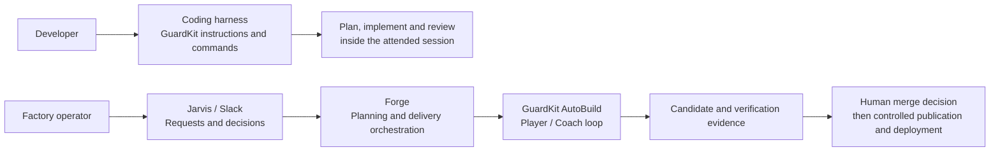

# GuardKit and the Software Factory

GuardKit helps turn a feature request into planned work, implementation and evidence.
You can use it **inside a coding harness**, where you direct the work, or as the
**AutoBuild engine inside the Software Factory**, where Forge coordinates a longer
delivery workflow.

These are different ways to work. Installing GuardKit does not install the factory,
and completing an AutoBuild task does not mean a feature has been deployed.

## Choose your starting point

| What you want to do | Start here | Who coordinates the work? |
|---|---|---|
| Plan and implement with an assistant in your editor or terminal | [Coding harness quickstart](guides/GETTING-STARTED.md) | You and your coding harness |
| Run a bounded Player/Coach build from a prepared task or feature | [AutoBuild architecture and entrypoints](deep-dives/autobuild-architecture.md) | GuardKit's build orchestrator |
| Submit work, review decisions and approve delivery through the factory | [Using the Software Factory](software-factory/using-the-factory.md) | Forge, with human decisions through Jarvis/Slack |
| Understand the services and agent interactions | [Factory architecture](software-factory/architecture.md) | C4 context and container views, plus a delivery sequence |
| Introduce AI-native development to a team | [Pathfinder playbook](learning/pathfinder-playbook.md) | A small team with explicit success measures |
| Prepare a presentation or video | [Presentation kit](learning/presentation-kit.md) | Suggested stories, diagrams, demonstrations and claim limits |

## Two paths, one important boundary

The coding harness and the factory may share task files, project guidance and
verification declarations. They do not share every command, permission or completion
rule. [Compare the workflows](guides/guardkit-workflow.md) before copying an example
from one path into the other.

## What makes the factory more than a coding agent?

The factory connects request intake, specification, planning, isolated implementation,
independent checks, review evidence and controlled publication. Jarvis presents the
conversation; Forge owns the workflow; GuardKit owns the build loop. The project
provides the commands and examples that define acceptable behaviour.

A model saying it has finished is one input. Tests, scenario checks, the exact Git
candidate, the human decision and the deployment outcome answer different questions.
The [delivery flow](software-factory/delivery-flow.md) explains where each fits.

## Current scope and evidence

The refreshed harness, factory and learning sections were checked on **17 October
2026** against named source revisions. AutoBuild's default is LangGraph; the current
factory Player uses deepagents-code, and knowledge capture uses fleet-memory.
Older SDK and Graphiti descriptions remain in historical reference material.

The factory has recorded working Slack approval and web-preview flows, alongside
planning failures and operational limitations. Private-repository intake and prototype
handover are work in progress at this snapshot. Start with
[evidence and limitations](software-factory/evidence-and-limits.md) for the scope of
those claims, and the [source register](software-factory/sources.md) for verification.

## Learn from the implementation

- [Engineering lessons](learning/lessons.md): failures, repairs and principles worth transferring.
- [Other software factories](learning/industry-comparison.md): primary-source research and a fair comparison.
- [Reusable field kit](learning/field-kit.md): feature contracts, decision records, experiments and handovers.
- [Learning routes](learning/index.md): a short introduction, an engineering walkthrough and team adoption.

Quality gates reduce specific risks when the right evidence reaches them. They do not
guarantee correct requirements, secure software or successful production operation.
