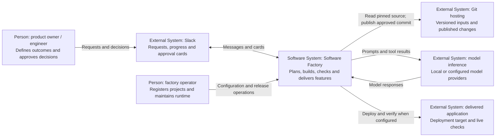
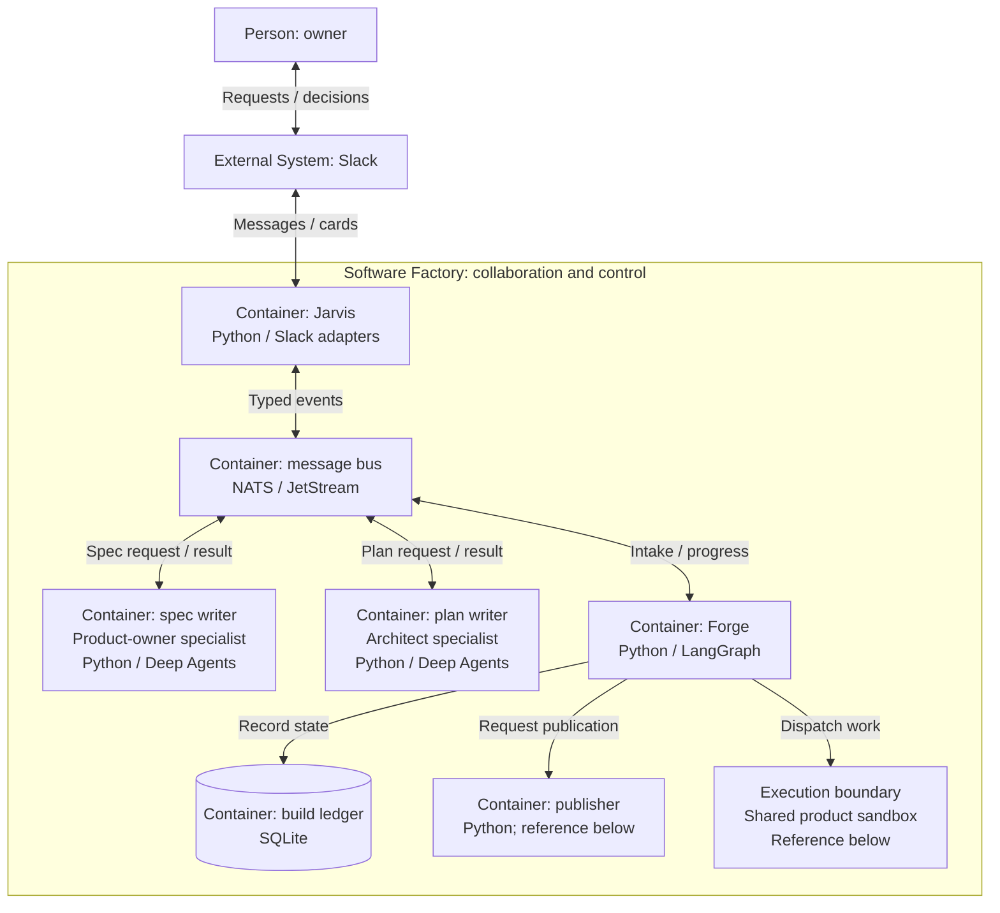
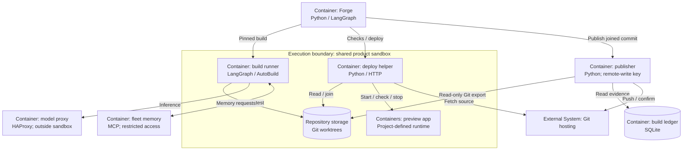

# Factory architecture

The factory separates conversation, coordination, execution and publication. Jarvis connects the person to the workflow; Forge owns the workflow; specialist agents prepare specifications and plans; GuardKit AutoBuild implements and verifies; a separate publisher controls the remote repository write.

*Reviewed 17 October 2026. The C4 views below describe the inspected implementation and deployed arrangement recorded at that date. They use ordinary Mermaid notation with explicit C4 types. An agent role is not automatically a separately deployed container.*

[Download the diagrams for slides](../learning/presentation-kit.md#reuse-the-diagrams).

## C4 level 1: system context

The system of interest is the Software Factory. Its users supply intent and decisions. Git hosting holds the source and receives approved changes. Model inference supplies reasoning. The delivered application is an output of the factory, with its own runtime and operational responsibilities.

Slack is the demonstrated attended surface for the current factory route. Other Jarvis adapters and general reasoning capabilities exist in the repository, but their presence does not establish the same operational proof for every channel.

## C4 level 2: containers and trust boundaries

In C4, a container means a running application or data store. These two complementary views separate collaboration from product execution so each remains readable. Machine names, ports and credentials are deployment settings and are omitted.

**Reading the views:** boxes name their C4 type and technology; cylinders represent stored data; enclosing boxes identify a system or execution boundary. Arrows name the interaction. A box marked “reference” points to detail in the other view, not another service.

### Collaboration and control

Use this view to explain who turns a request into planned work and who owns its decisions. The specialist containers write and review planning artefacts; the execution boundary contains the later coding work.

Model calls, memory retrieval and outcome recording are omitted here to keep the decision path visible. The second view shows the product's access boundaries. The [delivery sequences](delivery-flow.md) explain the ordering of dispatch, review and approval.

### Execution and publication

Use this view to explain where product code runs and why a successful build cannot publish itself. Forge and the ledger are the same containers as above. Player and Coach remain logical roles inside AutoBuild, not additional services.

Containers outside the sandbox boundary are control-side services: their credentials are outside product execution. The model proxy forwards to the configured inference service. Fleet memory exposes a restricted sandbox access port; that route is part of the memory service, not a separate invented proxy container. Its PostgreSQL store and NATS outcome relay are omitted from this view. The publisher alone holds the remote-write credential shown here, reads the coordinator's record independently, and uses a non-forcing push.

The current shared sandbox is an execution boundary between product code and the control services. **It is not a proven tenant boundary between mutually untrusted projects.** Per-project worktrees and memory names do not provide that isolation. Private/public separation is one of the open requirements in [evidence and limits](evidence-and-limits.md).

The diagram's memory arrow is a logical connection. The deployed sandbox uses a narrow memory access route rather than receiving the memory database credential. The coordinator has a separate direct read path for gate priors. See the [estate composition](https://github.com/guardkit/forge/blob/bec134d36a247008a3c64503c865d67268651a88/deploy/estate/compose.yaml) for the concrete service boundaries.

Gate-prior retrieval currently uses the configured `FORGE_MEMORY_PROJECT` scope
(default `guardkit`), not an automatic per-build project scope. Keep this distinction
from the build's explicit memory identity; neither naming scheme demonstrates tenant
isolation. [Prior retrieval](https://github.com/guardkit/forge/blob/bec134d36a247008a3c64503c865d67268651a88/src/forge/adapters/fleet_memory/priors.py).

## Responsibilities, in plain language

| Component | Owns | Important boundary |
| --- | --- | --- |
| Jarvis | The human communication channel | Routine Slack planning intake performs validation and forwarding; it does not run Jarvis's reasoning graph |
| Forge | State, orchestration, source identity, approvals and delivery | A model response is input to the workflow, not authority to publish |
| Product-owner specialist | Specification and behaviour examples | The current spec-writing leg receives supplied context; do not assume it explores the whole repository |
| Architect specialist | Task decomposition and plan review | The planning leg receives bounded repository facts and code evidence; other specialist modes have different tool access |
| GuardKit AutoBuild | Task execution and verification | Its Player/Coach loop is inside the build stage, not the entire factory |
| guardkitfactory | The AutoBuild harness implementation | This package is not the Forge service or the complete deployment |
| NATS / JetStream | Transport, durable streams and dispatch | The build ledger remains authoritative for build state |
| Fleet memory | Retrieved knowledge and recorded outcomes | Memory can inform a decision; it does not grant approval |
| Publisher | Remote repository write | It independently checks the ledger and Git ancestry before pushing |

The deterministic intake path is explicit in [Jarvis's Slack intake implementation](https://github.com/guardkit/jarvis/blob/2da5153e7c1cbc802f6d9c4d2f39c18a8245275e/src/jarvis/infrastructure/slack_planning_intake.py). This matters when explaining the architecture: a message passing through an agent application need not be an LLM call.

## Inside the build: roles, not another fleet

The **Player** changes the product and runs tools. The **Coach** assesses the result through the configured verification process. GuardKit controls the iteration, task outcomes and limits; the harness adapts the model/tool execution. A Coach verdict is separate from the person's approval to publish.

The current local Player uses the configured deepagents-code harness path; Coach execution and structured synthesis have distinct harness paths. Do not describe all reviewers as one permanently toolless agent: tool inventory depends on the role and invocation. The concrete implementation is in [LangGraphHarness](https://github.com/guardkit/guardkitfactory/blob/40615a7e0ff6952b5a5492ada0d3a66dc10c8533/src/guardkitfactory/harness/langgraph_harness.py).

Specialist planning also uses implementation/review patterns. Those planning reviewers evaluate a specification or plan; they are not the AutoBuild Coach reviewing a coding task. “Player/Coach” describes a cooperation pattern used at more than one level.

## Durable state and source identity

Forge records planning and build transitions in SQLite. NATS carries requests and notifications; loss of a progress notification should not rewrite the build's state. The [AutoBuild runner](https://github.com/guardkit/forge/blob/bec134d36a247008a3c64503c865d67268651a88/src/forge/subagents/autobuild_runner.py) explicitly retains the ledger as authority when lifecycle publication fails.

There are several identities worth keeping distinct:

| Identity | What it establishes |
| --- | --- |
| Request correlation ID | Which intake and replies belong together |
| Feature and build IDs | Which feature is being attempted in this run |
| Start/source commit | Which source, declarations and supplied artefacts were admitted |
| Candidate commit/tree | Which build output the offer describes |
| Preview tree | Which proposed integrated result the person saw |
| Joined commit | Which integration result checks and publication refer to |

These identities prevent “it passed somewhere” from becoming “this change is approved.” [Prepared admission](https://github.com/guardkit/forge/blob/bec134d36a247008a3c64503c865d67268651a88/src/forge/pipeline/prepared_admission.py) pins the input revision; the [publisher](https://github.com/guardkit/forge/blob/bec134d36a247008a3c64503c865d67268651a88/src/forge/publisher/service.py) checks the output identity independently.

## What these diagrams do not claim

The current deployment does not establish a general self-installing, multi-tenant factory. Configuration still matters, operators still release services, and some failure paths require intervention. It also does not require a separate model instance for every role: several roles can call the same inference service with different prompts and tool permissions.

Use the [sequence diagrams](delivery-flow.md) for ordering and approval behaviour. C4 explains who is responsible; a dynamic view explains when those responsibilities interact.
