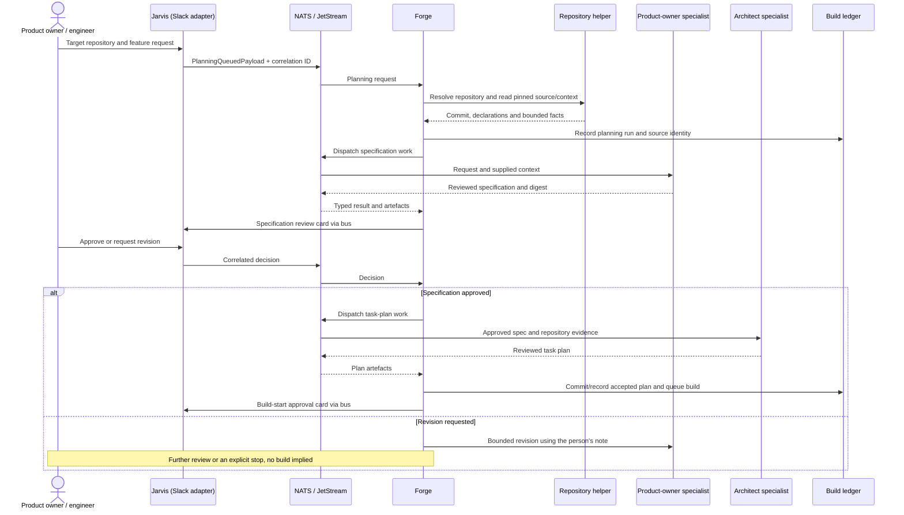
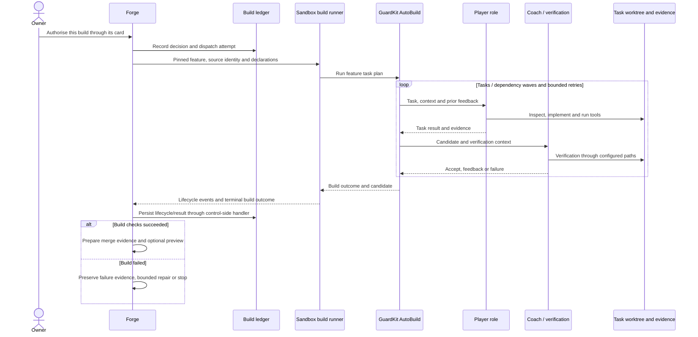
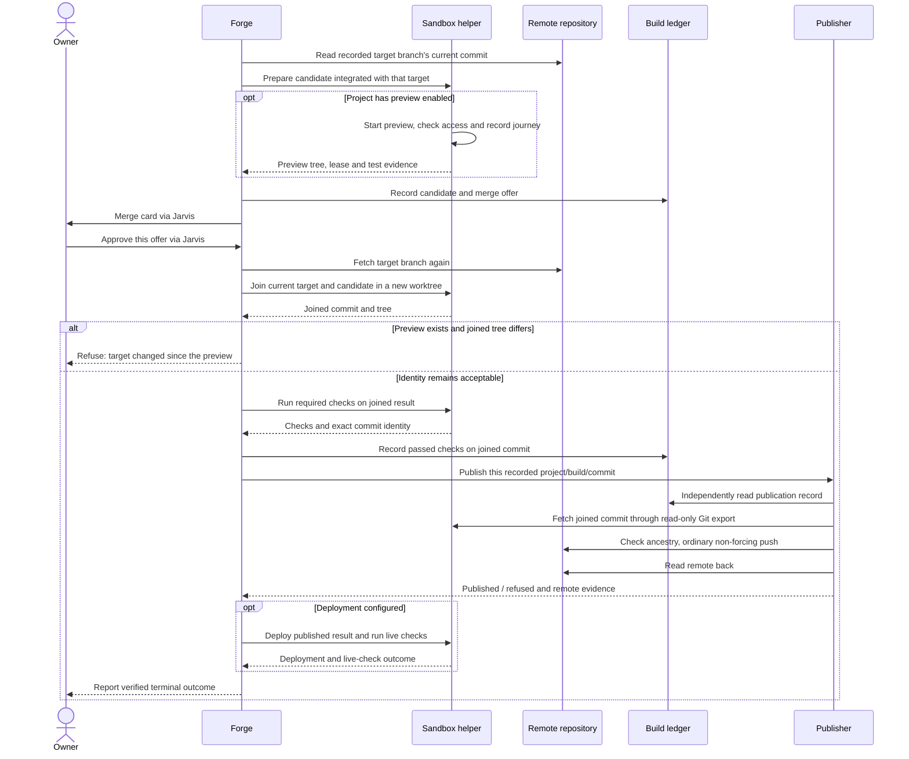

# From a request to checked delivery

The factory's delivery flow connects human intent to a particular Git result. Planning approval, build authorisation, task verification and merge approval each answer a different question.

*Reviewed 17 October 2026. These are dynamic views of the current route. Read them alongside the [C4 architecture](architecture.md) and [evidence and limits](evidence-and-limits.md).*

[Download full-size diagrams for slides](../learning/presentation-kit.md#reuse-the-diagrams).

## 1. Request, specification and task plan

For the ordinary sentence route, Jarvis passes an authorised Slack request to Forge. Forge resolves the repository, reads committed declarations and context, and drives the planning stages. The normal route asks the person to review a digest of the specification before authorising the build.

The spec writer and plan writer receive different context. In the inspected route, the spec writer receives the request, binding documents and repository facts; the plan writer also receives a bounded inventory and selected code evidence. A diagram that shows both freely browsing every repository would misrepresent this implementation. See the [planning driver](https://github.com/guardkit/forge/blob/bec134d36a247008a3c64503c865d67268651a88/src/forge/planning/driver.py).

Some files still name this area “Mode P” or show a full greenfield chain. Those are useful implementation labels, but they are not an instruction to run every upstream architecture stage for every feature.

## 2. The build contains the Player/Coach loop

Forge dispatches AutoBuild asynchronously so the coordinator can continue handling other work. The runner starts from the admitted revision in an isolated worktree. GuardKit executes the task plan and manages bounded implementation/verification iterations.

The verification arrow abstracts deterministic checks and model review; it does not claim that the Coach has unrestricted shell access. Nor does “accept” publish code. It lets the build advance to the next required step. The sandbox runner has no direct access to the control ledger; the control-side lifecycle handler records its events.

The [asynchronous dispatcher](https://github.com/guardkit/forge/blob/bec134d36a247008a3c64503c865d67268651a88/src/forge/pipeline/dispatchers/autobuild_async.py) records dispatch before starting the task. The [runner](https://github.com/guardkit/forge/blob/bec134d36a247008a3c64503c865d67268651a88/src/forge/subagents/autobuild_runner.py) owns execution and lifecycle transitions. This separation is important for recovering a long build after a coordinator interruption.

## 3. Evidence, human merge decision and publication

For a web project with previews enabled, the factory prepares the proposed integrated tree, runs the project's checks, and puts a running preview and evidence links on the merge card. The preview has a lease and an expiry. A rebuild prepares the same pinned candidate again; it is not permission to silently substitute a different feature.

The implementation uses a fresh integration worktree. It does not merge into whatever branch happens to be checked out in a shared project folder. The joined commit has the fetched target and candidate as its parents. The [join implementation](https://github.com/guardkit/forge/blob/bec134d36a247008a3c64503c865d67268651a88/src/forge/pipeline/merge_join.py) and [publisher](https://github.com/guardkit/forge/blob/bec134d36a247008a3c64503c865d67268651a88/src/forge/publisher/service.py) enforce different parts of this contract.

The publisher checks that the project, build, attempt, target branch and joined commit match its ledger record, and that required checks passed on that commit. It checks ancestry itself and uses a non-forcing push. It also refuses factory records and certain private operational material in the outgoing commits. This is a specific set of checks, not a claim that it detects every possible secret or malicious change.

## What the decisions mean

| Decision or result | Meaning | What it does not establish |
| --- | --- | --- |
| Specification approved | The stated behaviour and assumptions are acceptable | The implementation is correct |
| Build authorised | This work may consume factory execution resources | It may publish automatically |
| Coach accepts a task | The task satisfies that verification step | The integrated application works |
| Build complete | The build stage reached its successful terminal state | The change is on the remote or deployed |
| Merge approved | The person authorises the described candidate | Later identity or validation checks may be skipped |
| Published | The remote contains the joined commit | The deployment is healthy |
| Live check passed | The declared check passed on the deployed result | Every possible user journey is correct |

## Refusal, rejection and recovery

**A person rejecting a card** is a decision, not an infrastructure failure. Record it as such and retain enough context to understand the result. A refused merge must not be described as delivered.

**A failed build** should carry evidence about the failed stage. Bounded repair work may be created, but it must preserve the original specification and its approvals. A repair that changes the judgement criteria is not the same repair.

**An expired preview** cannot authorise an unseen result. Current preview handling updates the posted card and offers a bounded rebuild. When preview slots are busy, a card can report that state rather than wait indefinitely. See the [preview implementation](https://github.com/guardkit/forge/blob/bec134d36a247008a3c64503c865d67268651a88/src/forge/deploy/review_preview.py).

**A moved target branch** can make an otherwise reasonable candidate differ from what was previewed. The correct response is a new checked result and, where necessary, a new review; the earlier approval is not a wildcard.

**A restart** is not automatically harmless. Durable gates can be rearmed, but the preview implementation documents a gap when the coordinator restarts during preparation before the offer is recorded: the build can be complete with no merge card. That case refuses an unseen merge and requires recovery by rerunning the feature. See [evidence and limits](evidence-and-limits.md) before claiming fully unattended recovery.

## The transferable lesson

Design a pipeline so that each step can state its input identity, output identity, evidence and remaining authority. That makes the flow teachable, recoverable and auditable even when the model, harness or project stack changes.
