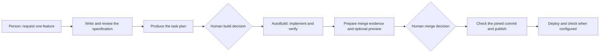

# The Software Factory

The Software Factory coordinates a feature from request to checked delivery. **GuardKit AutoBuild is its implementation engine. Forge coordinates the work; Jarvis carries requests and decisions between people and the factory.**

This is a different operating model from using GuardKit interactively in a coding harness. In a coding session, you drive the commands and inspect their outputs. In the factory, services retain the work's identity, dispatch planning and building, collect evidence, and wait at the decisions reserved for a person.

*Reviewed 17 October 2026. These pages distinguish implementation, recorded operational evidence and proposed work. The [evidence and limits](evidence-and-limits.md) page qualifies current capability; the [source register](sources.md) identifies the inspected revisions.*

## Choose the right starting point

| Your situation | Start here |
| --- | --- |
| You want to work through a feature in your editor or coding assistant | [GuardKit in a coding harness](../harness/index.md) |
| You want the factory to plan and build one request | [Using the factory](using-the-factory.md) |
| You already have an approved, committed specification and task plan | [Prepared feature intake](using-the-factory.md#send-an-already-planned-feature) |
| You want to understand Jarvis, Forge, the planners and AutoBuild | [Architecture](architecture.md) |
| You want to know what happens after you approve a card | [Delivery flow](delivery-flow.md) |
| You are onboarding a repository or teaching another team | [Project readiness](project-readiness.md) |
| You are preparing a presentation or a video | [Presentation kit](../learning/presentation-kit.md) |

## The distinction that prevents most confusion

There are three layers, with different responsibilities:

| Layer | Responsible for | Does it require the factory? |
| --- | --- | --- |
| **GuardKit workflow** | Specifications, plans, task work and quality conventions used inside a coding harness | No |
| **GuardKit AutoBuild** | Running a task plan through implementation and verification, including Player/Coach iteration | No; it can be invoked directly |
| **Software Factory** | Intake, durable orchestration, repository admission, remote execution, human decisions and controlled publication | Yes; this is the service deployment described here |

`guardkitfactory` is a package name, not the name of the whole deployed factory. It provides the LangGraph execution harness used by AutoBuild, alongside its backend, model and permission configuration. Forge remains the coordinator. This distinction is explicit in the [guardkitfactory package description](https://github.com/guardkit/guardkitfactory/blob/40615a7e0ff6952b5a5492ada0d3a66dc10c8533/README.md).

An attended workflow may prepare a feature for the factory. Its handoff is a committed bundle of files at an admitted Git revision. It is not a transcript that an unattended agent must reinterpret.

## A feature's journey

The diagram shows the normal sentence route. The specification review is also a human checkpoint; prepared intake starts with specification and planning already done. A failure can stop the journey or create bounded repair work. A successful build does not, by itself, mean the change was published or deployed.

The current normal interaction has three decisions: approve the specification, authorise the build, and approve the merge. These decisions are not three model votes. They express human intent at three different points. The [merge-ready checkpoint](https://github.com/guardkit/forge/blob/bec134d36a247008a3c64503c865d67268651a88/src/forge/pipeline/merge_ready_checkpoint.py) explicitly preserves the human merge decision.

## What the factory adds

The factory takes responsibility for details that are easy to leave implicit in a conversation:

- **Which repository and revision?** Intake resolves a registered project and records the source commit, target branch and project declarations.
- **Which evidence belongs to this work?** Correlation IDs, the build ledger, candidate commits and tree identities connect requests, decisions and results.
- **Where may code run?** The deployed factory routes product execution into its sandbox. This policy depends on deployment configuration; it is not a universal default of every Forge installation.
- **Who may publish?** A separate publisher holds the repository write credential and checks the coordinator's record independently.
- **What did the person actually approve?** A merge card names the candidate; a web preview, when configured, is tied to the tree that approval would merge.
- **What happens after a restart?** Durable records support recovery, although [some recovery gaps remain](evidence-and-limits.md).

These are delivery controls around the agent loop. More agents would not replace them.

## Current capability and its limits

Recorded October runs demonstrate the sentence-to-build journey, Slack approval, checked publication, web previews, and refusing a merge when the target branch has moved beyond the previewed result. They also demonstrate failures: malformed planning output, resource constraints and factory defects that required repair. Read these as operational examples, not a general success-rate benchmark.

As of this review, private repository intake and signed-off prototype import are still work in progress. Shared runtime and memory boundaries make that a larger problem than adding a Git credential. Do not use the public-project deployment described here as evidence that a client-confidential workflow is ready.

The factory dashboard is also not yet a trustworthy delivery or cost reporting surface. The [evidence and limits](evidence-and-limits.md) page separates what has been restored from what remains incomplete.

## What another team can take from this

The most transferable part is the operating model: explicit inputs, independent evidence, constrained execution and clear human ownership. A pathfinder team can adopt those practices with one repository and one coding harness before operating a message bus, a model service or a multi-agent factory.

Use the [pathfinder playbook](../learning/pathfinder-playbook.md) to turn these principles into a pilot, and the [industry comparison](../learning/industry-comparison.md) to assess them against other approaches rather than treating this implementation as a finished reference architecture.
